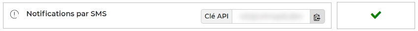

# Free Mobile for F#
Send SMS messages to your [Free Mobile](https://mobile.free.fr) device via any internet-connected device.

For example, you can configure a control panel or storage connected to your home network to send a notification to your mobile phone when an event occurs.

## Quick start
> [!NOTE]
> SMS notifications require an API key. If you are not already registered,
> [sign up for a Free Mobile account](https://mobile.free.fr/subscribe).

### Get an API key
You first need to enable the **SMS notifications** in [your subscriber account](https://mobile.free.fr/account).
This will give you an identification key allowing access to the [Free Mobile](https://mobile.free.fr) API.



### Get the library
Install the latest version of **Free Mobile for F#** with [NuGet](https://www.nuget.org) package manager:

```powershell
dotnet package add Belin.FreeMobile.FSharp
```

For detailed instructions, see the [installation guide](Installation.md).

## Usage
This library provides the `Client` class, which allow to send SMS messages to your mobile phone by using the `SendMessageAsync()` method:

```fsharp
open Belin.FreeMobile

async {
  use client = new Client("your account identifier", "your API key")
  match! client.SendMessageAsync "Hello World from F#" with
  | Ok _ -> printfn "The message was sent successfully."
  | Error error -> printfn $"An error occurred: {error.Message}"
}
```

The `Client.SendMessageAsync()` method returns an `Async<Result>` that describes whether the message was sent successfully.

> [!WARNING]
> The text of the messages will be automatically truncated to **160** characters:  
> you can't send multipart messages using this library.
